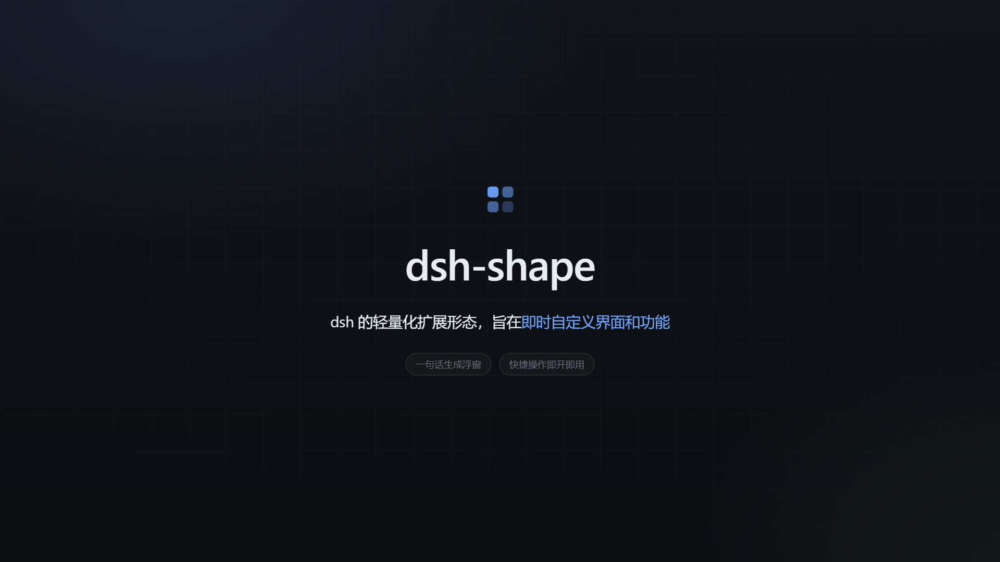

# dsh-shape

[English](README.en.md) | [中文](README.md)

[](https://github.com/belowthetree/dsh-shape/blob/main/demo/dsh-shape-demo.mp4)

dsh-shape is a DeepSeek Harness plugin that extends DSH's UI, chat cards, and page-level shortcuts through shape folders.

## What it can do

- **Shape browser**: open an app grid from the conversation header and browse every shape; press `Ctrl + .` to open it quickly
- **Dedicated views**: click a shape card to show that shape's own interface in a second window
- **Conversation slots**: nine slots — the card stack above the composer, the info strip below it, the floating panel above it (anchored or free-floating with viewport edge snapping), status chips in the composer tool row and Session header, New Session options, and View menu rows; client modules can also render their own DOM into a supported slot with `api.mount()`
- **Per-shape switches**: enable or disable each shape independently; turning one off also disables its view, slot entries, and client logic
- **Client behavior**: shapes can register page-level behavior and shortcuts, and read only the capability APIs they declare
- **Shape deletion**: a delete button on each card removes that shape's folder from disk after confirmation
- **Capability requirements**: shapes declare required plugin capabilities and versions; missing dependencies prevent startup and hide their slot entries
- **Capability catalog**: inspect which capabilities are available to shapes, including versions, purpose, usage, and API method names
- **Built-in capabilities**: `dsh-shape#workspace` switches workspaces; `dsh-shape#ui` controls the surface — navigate Sessions and Workspaces, toggle the sidebar, switch main panels and themes, send or cancel turns, raise toasts, and open the Shapes browser; `dsh-shape#shortcuts` registers shape actions as DSH commands that users can rebind in Settings; `dsh-shape#slots` discovers slots, mounts into them at runtime, and counts occupancy; `dsh-shape#events` shares events between shapes; `dsh-shape#storage` persists JSON under the shape's own `data/` directory
- **Instant updates**: add or edit a shape folder and refresh; no DSH restart is needed

## Demo


36-second feature demo: [1080p MP4](https://github.com/belowthetree/dsh-shape/blob/main/demo/dsh-shape-demo.mp4) · [source and reproduction steps](https://github.com/belowthetree/dsh-shape/tree/main/demo)

## Shape Studio preset

Installation adds the **Shape Studio** preset for developing shapes and extension plugins:

- Tools to list, inspect, scaffold, and validate shapes, plus a shape capability catalog
- A shape-development skill plus a topic-based reference for the full interfaces and rules
- Cordis inspection, plugin installation/management, and the plugin market
- Skills for plugin development and preset editing

These tools and skills are visible only in Shape Studio; other presets never see them.

## Install

npm package: **`@belowthetree/dsh-shape`**

```sh
dsh plugin --profile <profile> add @belowthetree/dsh-shape
```

Replace `<profile>` with the profile to install into (`desktop`, `web`, …), then restart that profile.

Other ways to install:

- GitHub repository: `dsh plugin --profile <profile> add github:belowthetree/dsh-shape`
- Local development: `dsh plugin --profile <profile> add link:/path/to/dsh-shape`
- Plugin manager: install by package name `@belowthetree/dsh-shape` or repository `belowthetree/dsh-shape`

Requires DSH `>= 0.2.2-rc.1`. After startup, click **Shapes** in the conversation header or press `Ctrl + .`.

> Upgrading from the old unscoped `dsh-shape`: run `dsh plugin --profile <profile> remove dsh-shape`, install with the command above, then change `dsh-shape` to `@belowthetree/dsh-shape` in the profile's `dsh.profile.bundles`.
