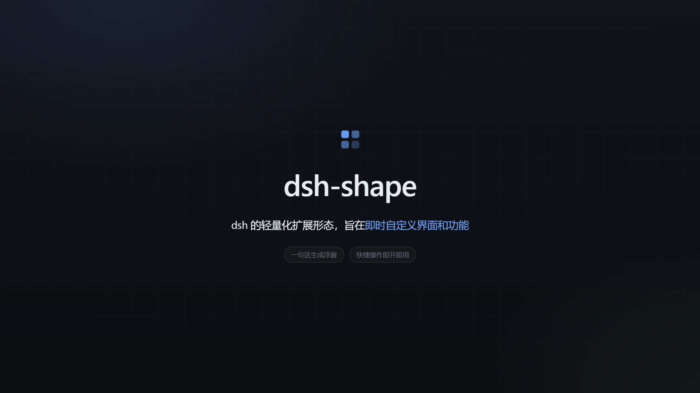

# dsh-shape

[中文](README.md) | [English](README.en.md)

[](https://github.com/belowthetree/dsh-shape/blob/main/demo/dsh-shape-demo.mp4)

dsh-shape 是 DeepSeek Harness 插件，提供一种**动态轻量扩展形态**：一个 shape（形态）就是一份清单加可选脚本，即时给 DSH 加上界面、聊天卡片和页面级快捷操作。

## 能做什么

- **Shape 浏览器**：在对话顶栏打开应用网格，浏览所有形态；按 `Ctrl + .` 快速打开
- **独立视图**：点击形态卡片，在第二个窗口展示该形态自己的界面
- **会话槽位**：10 个槽位可选——输入框上方的卡片栈、下方的信息条、上方的浮窗（可固定、可自由浮动、靠近屏幕边缘自动吸附）、输入条左右与顶栏的状态 chip、New Session 选项、View 菜单行，以及覆盖全应用的全屏层（片头、命令面板这类）；客户端模块还能用 `api.mount()` 在受支持槽位里渲染自己的 DOM
- **浮动面板**：`api.panel()` 注册一个面板，`open()` 后作为浮动窗口出现在会话输入区上方——可拖动、可吸附到屏幕边缘、自动记住位置，随形态停用一起消失
- **右侧页签**：`api.tab()` 往右侧栏加一种页面，`open()` 打开，同一页重复打开只聚焦不重复
- **边缘弹窗**：`api.edge()` 注册一个从屏幕**上/右/下/左边缘居中滑入**的窗口，内容是形态 `views/` 目录里的页面；`keys` 直接绑定快捷键，`Esc` 关闭（`esc: false` 关掉），尺寸按边缘给默认值，也可用 `width`/`height` 覆盖
- **单个开关**：每个形态独立启停；关闭后它的视图、槽位条目和客户端逻辑一起失效
- **客户端逻辑**：形态可以注册页面级行为和快捷键，并按需读取已声明能力的接口
- **删除形态**：卡片右上角的删除按钮，确认后把该形态目录从磁盘移除
- **能力依赖**：形态声明需要的插件能力与版本，缺少依赖时不会启动，也不会显示槽位条目
- **能力目录**：可以查看当前有哪些形态可用能力、版本、用途、用法和 API 方法名
- **内置能力**：9 个内置能力覆盖工作区切换、界面控制、快捷键、槽位、事件、存储、输入框与对话读取，见下文[内置能力](#内置能力)
- **内置形态**：随包提供 `chat-search`（对话内搜索，Ctrl+F）和 `workspace-tab-switch`（工作区切换器，Ctrl+Tab），可在形态面板里启停或删除；用户目录下同 id 的形态会覆盖它们
- **即时生效**：修改形态目录里已有文件后刷新页面即可；新增或删除文件需先在形态面板点刷新（或 `POST /dsh-shape/api/refresh`），面板会自动重载页面

## 内置形态

装好即可用，不用自己创建：

| 形态 | 触发 | 作用 |
| --- | --- | --- |
| `chat-search` | `Ctrl + F`，或顶栏 🔍 | 在对话里查找文本：命中高亮、折叠的思考内容自动展开、滚动到命中；`F3` / `Shift + F3` 上下一条，`Esc` 关闭 |
| `workspace-tab-switch` | 按住 `Ctrl` 连按 `Tab` | 弹出工作区预览条，松手切到高亮项；`Ctrl + Shift + Tab` 反向，方向键移动，`Esc` 取消 |

两者都在包内 `shapes/` 里，可在 Shapes 面板启停或删除。想改造就把目录复制到用户目录并保持同名 id——用户版本会覆盖内置版本，升级插件不会冲掉你的改动。

## 内置能力

形态在 `package.json` 的 `shape.requires` 里声明需要的能力，再用 `api.require('dsh-shape', '<能力>')` 取用；缺少能力或版本不匹配时形态不会启动。

| 能力 | 版本 | 方法 | 用途 |
| --- | --- | --- | --- |
| `dsh-shape#core` | 1.0.0 | 字段 `apiVersion` | 判断形态 ABI |
| `dsh-shape#workspace` | 1.0.0 | `list` `current` `next` `previous` | 切换工作区，并展开、滚动到目标分组 |
| `dsh-shape#ui` | 1.0.0 | `openSession` `openWorkspace` `toggleSidebar` `selectPanel` `getTheme` `setTheme` `send` `cancelTurn` `notify` `openShapeBrowser` | 控制 DSH 界面：导航、面板、主题、对话、通知、打开 Shapes |
| `dsh-shape#shortcuts` | 1.0.0 | `register` `list` | 把形态动作注册成 DSH 命令，用户可在设置里重绑；`regions` 决定输入框聚焦时是否也触发 |
| `dsh-shape#slots` | 1.0.0 | `list` `mount` `entries` | 查询 10 个槽位、运行时挂载、统计占用 |
| `dsh-shape#events` | 1.0.0 | `emit` `on` | 形态之间收发事件 |
| `dsh-shape#storage` | 1.0.0 | `get` `set` `remove` `keys` | JSON 数据存到形态目录的 `data/` 下 |
| `dsh-shape#composer` | 1.0.0 | `getText` `setText` `insert` `submit` `sessionId` | 读写当前输入框草稿，可插入或直接发送 |
| `dsh-shape#conversation` | 1.0.0 | `messages` `find` `reveal` `subscribe` | 读取已渲染的对话、搜索并跳转到某条消息 |

```js
const ui = api.require('dsh-shape', 'ui')
const shortcuts = api.require('dsh-shape', 'shortcuts')
const store = api.require('dsh-shape', 'storage')

shortcuts.register({ id: 'summary', label: '显示 MCP 摘要', keys: 'Ctrl+Alt+M', run: () => ui.notify('3 个服务器') })
await store.set('collapsed', true)   // → <shape>/data/collapsed.json
```

`shape_capabilities` 工具会列出当前所有能力、版本、用途、用法和 API 方法名。

## 文档

- [文档索引](docs/README.md)
- [架构](docs/architecture.md)：宿主插件、客户端 bundle、形态加载与能力系统
- [形态目录](docs/shapes.md)：清单字段、视图、槽位条目、客户端模块
- [能力参考](docs/capabilities.md)：9 个能力的方法、返回值与失败行为
- [开发与发布](docs/development.md)：本地联调、发布前检查、client.js 拼接注意事项
- [已知问题](docs/known-issues.md)：当前不可用的 API 与踩过的坑

仓库里有三份 skill：`skills/shape-development/` 教 agent 写形态、`skills/shape-playbook/` 是经验流程文档（已验证的各类形态做法，加上 UI 不渲染、快捷键被拒、搜索/展开/高亮、预设判定损坏这些坑），两份都随包发布并由 Shape Studio 预设注册；`.dsh/skills/dsh-shape-contribution/` 教 agent 改这个包本身，放在 DSH 的**项目级技能目录**里，在本仓库工作时任何预设都能用。

## 演示


22 秒功能演示：[1080p MP4](https://github.com/belowthetree/dsh-shape/blob/main/demo/dsh-shape-demo.mp4) · [演示源码与复现步骤](https://github.com/belowthetree/dsh-shape/tree/main/demo)

## Shape Studio 预设

安装后新增 **Shape Studio** 预设：在标准预设的基础上，去掉 shell 和通用文件读写，换成按形态限定的文件工具。

- 查看、检查、创建、校验形态：`shape_list`、`shape_inspect`、`shape_scaffold`、`shape_validate`、`shape_test`
- 按形态限定范围的文件访问：`shape_read`、`shape_write`（必须指定形态 id，路径相对该形态目录）
- 目录结构与文本检索：`shape_tree`、`shape_grep`
- 能力目录查询：`shape_capabilities`；规范查询：`shape_spec`（含 `playbook` 经验流程主题）
- 附带两份 skill：`shape-development`（契约与写法）、`shape-playbook`（已验证的各类形态流程与踩过的坑）
- 其余能力与标准预设一致：Web 搜索与抓取、后台任务、定时任务、目标与规划、子代理与工作流、待办、`present`、插件管理

**只有两处缺口**：没有 `bash`/`pwsh`，也没有 `tool-fs`/`tool-fs-search`——所以形态目录之外的文件它读写不到，形态文件一律走 shape 工具。这些工具和 skill 只在 Shape Studio 中可见，其他预设不会看到。

## 安装

npm 包名：**`@belowthetree/dsh-shape`**

```sh
dsh plugin --profile <profile> add @belowthetree/dsh-shape
```

把 `<profile>` 换成要安装的 profile（如 `desktop`、`web`），然后重启该 profile。

其他安装方式：

- GitHub 仓库：`dsh plugin --profile <profile> add github:belowthetree/dsh-shape`
- 本地开发：`dsh plugin --profile <profile> add link:/path/to/dsh-shape`
- 插件管理器：在 DSH 的插件管理器中按包名 `@belowthetree/dsh-shape` 或仓库 `belowthetree/dsh-shape` 安装

要求 DSH `>= 0.2.2-rc.1`。安装后点击对话顶栏的 **Shapes**，或按 `Ctrl + .` 打开。

> 从旧的无作用域包名 `dsh-shape` 升级：先 `dsh plugin --profile <profile> remove dsh-shape`，再按上面的命令安装，最后把 profile 的 `dsh.profile.bundles` 里的 `dsh-shape` 改成 `@belowthetree/dsh-shape`。

---

[](https://github.com/deepseek-ai/deepseek-harness)
